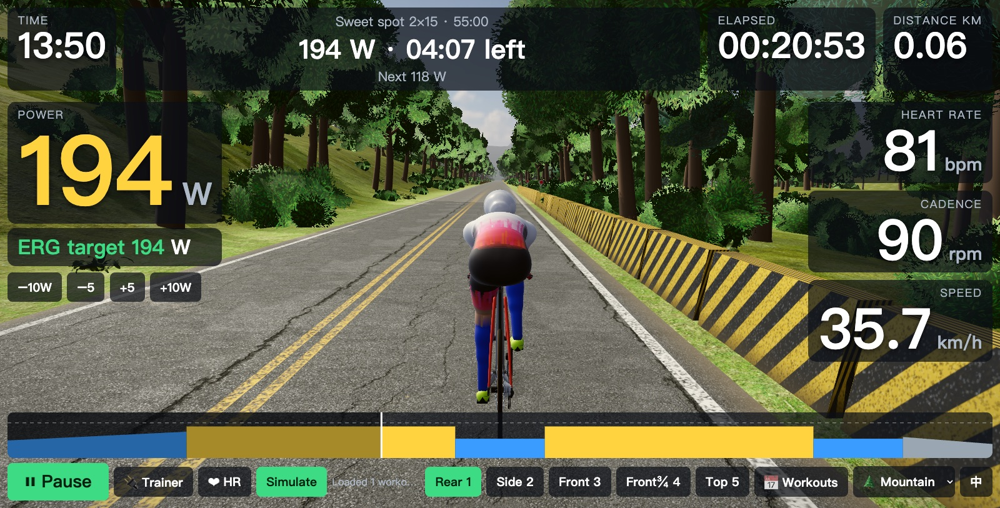
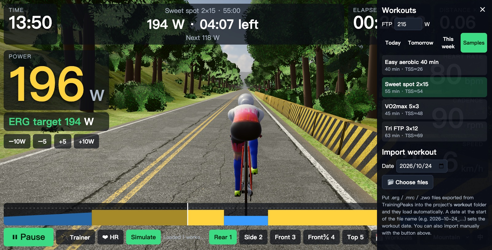

# Iron Hud Virtual Cycling

[繁體中文](README.md) | **English**

A browser-based smart trainer app (a first take on something like Zwift / Rouvy). The interface switches between Chinese and English on the fly.



## Features
- Connects to smart trainers (FTMS) and heart rate straps over Web Bluetooth
- ERG mode on by default: trainer resistance follows the workout's target power as soon as a workout is selected, with ±5 / ±10 W fine-tuning
- Workouts: drop `.erg` / `.mrc` / `.zwo` / `.json` files exported from TrainingPeaks into the `workout/` folder and they load automatically (a leading date such as `2026-10-24_…` sets the workout date; ERG watts are scaled using the FTP in the file). Manual import is also supported. Workouts are grouped into Today, Tomorrow and This week, plus built-in samples
- Large, readable metrics: power (zone-colored), ERG target, heart rate, cadence, speed, distance, elapsed time, time left in the current interval, and a workout profile chart
- 3D world (Three.js): a tri bike and rider whose pedaling follows your cadence; rear, side, front, front-¾ and top camera views
- Switch scenes or language mid-ride without losing workout progress or the Bluetooth connection

| Front-¾ view | Workout panel |
|---|---|
|  |  |

## Running
```bash
python3 tools/serve.py        # local server with caching disabled, so a refresh always loads your latest changes
```
Open http://localhost:8000 in Chrome or Edge (Web Bluetooth requires localhost or https).
No trainer? Press **Simulate** to preview.

Shortcuts: `1`–`5` camera views, Space start/pause, Up/Down arrows adjust the ERG target by ±5 W, `L` toggles 中文 / English.

## Scenes
- 🌲 Mountain: a procedurally generated, endless tree-lined mountain road (default)
- 🏙 Yuanshan Interchange (experimental): the area around Taipei's Yuanshan Interchange, built from OpenStreetMap data; ride about 3.65 km northbound along the National Freeway 1 mainline. Switch with the menu at the bottom right or the `?map=yuanshan` URL parameter.
  To re-fetch the map data: `/opt/homebrew/bin/python3 tools/fetch_osm.py`


## License
- Code: [MIT License](LICENSE)
- `assets/osm/yuanshan.json`: derived from OpenStreetMap data, © [OpenStreetMap](https://www.openstreetmap.org/copyright) contributors, available under the [ODbL 1.0](https://opendatacommons.org/licenses/odbl/1-0/) (not MIT)
- `assets/hdri/`, `assets/tex/`, `assets/models/`: the HDRI sky, asphalt/grass textures and grass/fern/rock models come from [Poly Haven](https://polyhaven.com) under [CC0](https://creativecommons.org/publicdomain/zero/1.0/) (public domain)

## Disclaimer
This is a personal, non-commercial project. It is not affiliated with, authorized or endorsed by Zwift, Rouvy, TrainingPeaks, Garmin, Specialized, Zoot or any other company mentioned. All product names and trademarks belong to their respective owners and are used only to describe compatibility or for identification. The 3D bike and clothing are procedurally drawn approximations and use no official artwork or logos.
