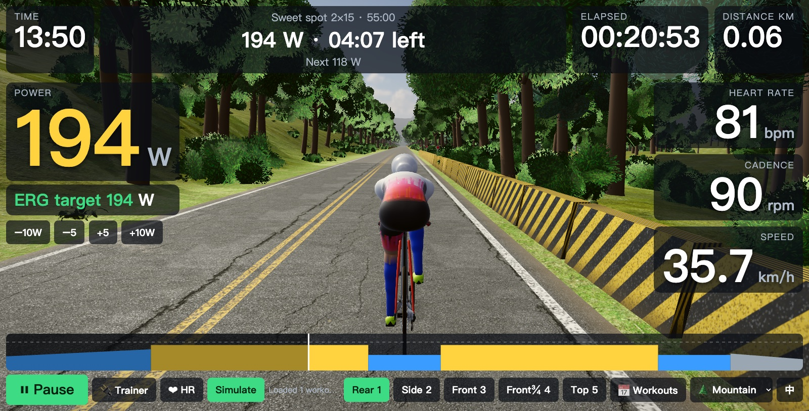
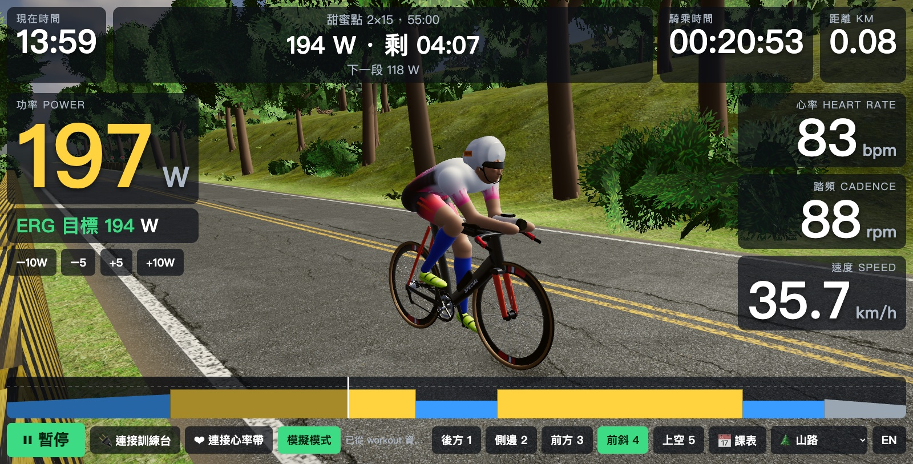
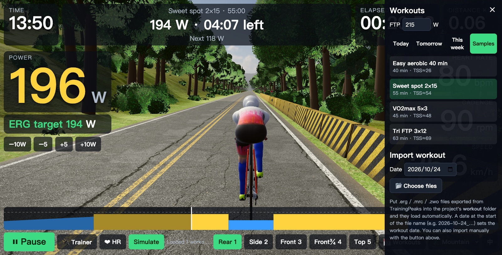
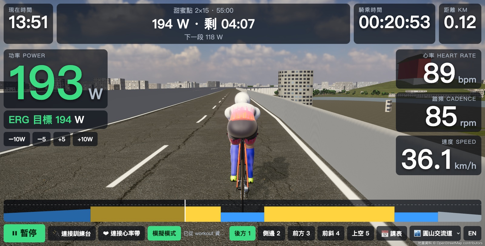
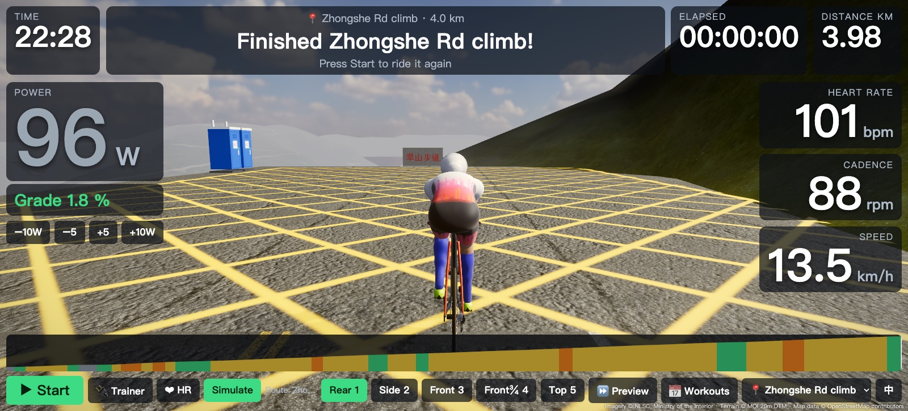
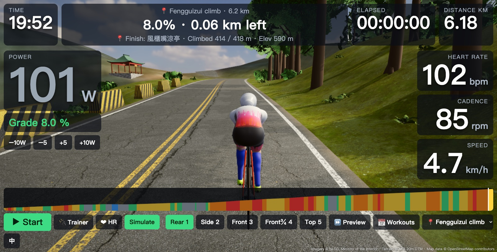

# Hud Iron Virtual Cycling

[繁體中文](README.md) | **English**

*"Hud Iron" sounds like 哈鐵 (crazy about triathlon) in Taiwanese Mandarin.*

A browser-based smart trainer app (a first take on something like Zwift / Rouvy). The interface switches between Chinese and English on the fly.

**Current version: v0.2.0** (2026-11-01)

### New in v0.2.0
- Ride imported GPX routes: trainer resistance follows the gradient (FTMS SIM mode), speed is computed from power and gradient, and the HUD shows gradient, distance left, climbing and an elevation profile
- Preview fast-forward (button or P key, 1× / 4× / 16×); click the elevation profile to jump anywhere on the route
- Built-in real-terrain route, the Zhongshe Rd climb: MOI DTM terrain, NLSC orthophotos, OpenStreetMap buildings / roads / streams, and the Waishuangxi Bridge at the start
- Built-in real-terrain route, the Fengguizui climb: Fenglin Bridge up to the Fengguizui saddle (6.3 km, ~420 m of climbing), finishing at the Fengguizui pavilion, past the 佛 inscription rock face
- Landmarks along the way: Cuishan Police Station, Shuangxi Elementary School and bus stops; at the finish, the bus turnaround with its yellow cross-hatch, portable toilets and the Cuishan Trail stone marker. The HUD names each one as you approach
- `tools/make_route_gpx.py`: build a GPX file and real-scene data from OpenStreetMap road names

v0.1.0: ERG workouts, Web Bluetooth trainer / HR strap, 3D world with five camera views, Yuanshan Interchange scene, live Chinese / English switching



## Features
- Connects to smart trainers (FTMS) and heart rate straps over Web Bluetooth
- ERG mode on by default: trainer resistance follows the workout's target power as soon as a workout is selected, with ±5 / ±10 W fine-tuning
- Workouts: drop `.erg` / `.mrc` / `.zwo` / `.json` files exported from TrainingPeaks into the `workout/` folder and they load automatically (a leading date such as `2026-10-24_…` sets the workout date; ERG watts are scaled using the FTP in the file). Manual import is also supported. Workouts are grouped into Today, Tomorrow and This week, plus built-in samples
- Large, readable metrics: power (zone-colored), ERG target, heart rate, cadence, speed, distance, elapsed time, time left in the current interval, and a workout profile chart
- 3D world (Three.js): a tri bike and rider whose pedaling follows your cadence; rear, side, front, front-¾ and top camera views
- GPX route riding: import your own GPX files; trainer resistance follows the route's gradient (FTMS SIM mode), speed is computed live from power and gradient, and the HUD shows gradient, distance left, climbing and an elevation profile. Includes two real-terrain routes, the Zhongshe Rd climb and the Fengguizui climb (real terrain, aerial imagery, buildings and roads)
- Switch scenes or language mid-ride without losing workout progress or the Bluetooth connection

| Front-¾ view | Workout panel |
|---|---|
|  |  |

## Running
```bash
python3 tools/serve.py        # local server with caching disabled, so a refresh always loads your latest changes
```
Open http://localhost:8000 in Chrome or Edge (Web Bluetooth requires localhost or https).
No trainer? Press **Simulate** to preview.

Shortcuts: `1`–`5` camera views, Space start/pause, Up/Down arrows adjust the ERG target by ±5 W, `L` toggles 中文 / English.

## Scenes
- 🌲 Mountain: a procedurally generated, endless tree-lined mountain road (default)
- 🏙 Yuanshan Interchange (experimental): the area around Taipei's Yuanshan Interchange, built from OpenStreetMap data; ride about 3.65 km northbound along the National Freeway 1 mainline. Switch with the menu at the bottom right or the `?map=yuanshan` URL parameter.
  To re-fetch the map data: `/opt/homebrew/bin/python3 tools/fetch_osm.py`



## GPX routes
- Pick a route in the **Routes** section of the workout panel, or press **📂 Import GPX**. You can also drop `.gpx` files into the `routes/` folder (personal routes, never uploaded to GitHub) and they load automatically.
- Without a workout, trainer resistance follows the gradient (SIM mode). With a workout selected, the trainer still holds the workout watts (ERG) and the route only drives the scenery and speed.
- Speed comes from a physics model: rider + bike 82 kg, CdA 0.24, Crr 0.004, so you slow down on climbs and speed up on descents.
- Built-in real-terrain sample: Zhongshe Rd in Shilin, Taipei (about 4.0 km, 252 m of climbing, 6.3% average):
  - The road comes from OpenStreetMap; its elevation and the surrounding 3.7 × 3.1 km of terrain come from Taiwan's Ministry of the Interior 20 m digital terrain model (DTM)
  - Ground colours come from NLSC orthophotos, streamed live from the NLSC tile service while you ride (not stored in the repo; needs internet, falls back to plain grass offline)
  - Buildings, side roads and streams are placed from OpenStreetMap, and trees are only planted where the orthophoto shows vegetation, with fewer roadside trees where there are houses. Tree models and building facades are still procedural, so close up it is not real scenery
  - Road width follows each OSM segment (wider at the junction, narrower on the upper mountain section, widened on hairpins). The Waishuangxi Bridge at the start has a deck, parapets and piers, with the stream flowing underneath
  - Landmarks along the way: Cuishan Police Station (white walls, blue band and sign), Shuangxi Elementary School (buildings, fence, gate sign, courts), 31 bus stop signs, and the Zhongshe bus turnaround with its yellow cross-hatch box at the finish, with two blue portable toilets and the stone marker at the Cuishan Trail entrance beside it. The HUD shows each landmark's name as you approach
- Built-in real-terrain route: Fengguizui in Shilin, Taipei (about 6.3 km, 420 m of climbing, 6.6% average), northern Taiwan's classic cycling climb. It starts at Fenglin Bridge on Zhishan Rd Sec. 3, takes Lanes 150, 290 and 336, then the Wanxi farm road up to the Fengguizui saddle on the Shilin / Wanli border
  - Built the same way as Zhongshe Rd; the east side of the saddle is in New Taipei, so that city's DTM is merged in
  - The finish is the Fengguizui pavilion (position and size from OSM, with green upturned-eave tiles, wood-grain pillars, a stone platform and a 風櫃嘴 plaque; it is a generic mountain pavilion style, not modelled from photos). The finish junction is paved and joins the Wankan Rd and the Wanxi farm road. Bus stops line the way
  - About 830 m before the finish, a rock face on the slope bears a red 佛 ("Buddha") character (position from the rock mapped in OSM; OSM does not record inscriptions, so the text is set with `--inscription`). Over the last ~1 km the left side has no trees, keeping the open mountain view (`--open`)
- Generate another route by road name:
  ```bash
  /opt/homebrew/bin/python3 tools/make_route_gpx.py 中社路 --names 中社路一段,中社路二段,外雙溪橋 \
      --bbox 25.08,121.52,25.16,121.60 --title 中社路 --out assets/routes/zhongshe.gpx
  ```
  When roads with the same name branch and you only ride part of them, add `--from lat,lon --to lat,lon` to take the shortest path between two points, e.g. Fengguizui:
  ```bash
  /opt/homebrew/bin/python3 tools/make_route_gpx.py 風櫃嘴 --names 楓林橋,至善路三段150巷,至善路三段290巷,至善路三段336巷,萬溪主線產業道路 \
      --bbox 25.10,121.56,25.15,121.62 --from 25.11922,121.58272 --to 25.13715,121.60264 --title 風櫃嘴 --out assets/routes/fengguizui.gpx \
      --dem .cache/dem/taipei,.cache/dem/newtaipei --scene assets/routes/fengguizui.scene.json \
      --inscription 25.13051,121.59872,佛 --open 5200-:L --skip 溪山派出所
  ```
  Add `--dem .cache/dem/taipei --scene assets/routes/zhongshe.scene.json` to use the MOI DTM and export real-scene data (for routes that cross a county line, list several folders separated by commas). Download the county sheet (e.g. `分幅_臺北市20MDEM(2024).zip`) from the "全臺灣20公尺網格數值地形模型DTM資料" dataset on data.gov.tw and unzip it into a folder under `.cache/dem/`. Without `--dem`, elevation comes from SRTM / ASTER 30 m.





## License
- Code: [MIT License](LICENSE)
- `assets/osm/yuanshan.json`, `assets/routes/*.gpx`, `assets/routes/*.scene.json`: derived from OpenStreetMap data, © [OpenStreetMap](https://www.openstreetmap.org/copyright) contributors, available under the [ODbL 1.0](https://opendatacommons.org/licenses/odbl/1-0/) (not MIT)
- Elevation in `assets/routes/*.gpx` and terrain in `assets/routes/*.scene.json`: MOI 20 m DTM, under the [Open Government Data License, version 1.0](https://data.gov.tw/license); buildings, roads and streams in `*.scene.json` remain under the ODbL
- Orthophotos: © National Land Surveying and Mapping Center (NLSC), streamed live from its WMTS service; this repo contains no imagery tiles. The `docs/screenshots/route-*.jpg` screenshots include rendered imagery and are shown with attribution under the [NLSC terms of use](https://maps.nlsc.gov.tw/pro/use_clause.jsp)
- Routes generated without the DTM use SRTM (NASA, public domain) and ASTER GDEM (METI / NASA) elevation, queried through [OpenTopoData](https://www.opentopodata.org)
- `assets/hdri/`, `assets/tex/`, `assets/models/`: the HDRI sky, asphalt/grass textures and grass/fern/rock models come from [Poly Haven](https://polyhaven.com) under [CC0](https://creativecommons.org/publicdomain/zero/1.0/) (public domain)

## Disclaimer
This is a personal, non-commercial project. It is not affiliated with, authorized or endorsed by Zwift, Rouvy, TrainingPeaks, Garmin, Specialized, Zoot or any other company mentioned. All product names and trademarks belong to their respective owners and are used only to describe compatibility or for identification. The 3D bike and clothing are procedurally drawn approximations and use no official artwork or logos.
