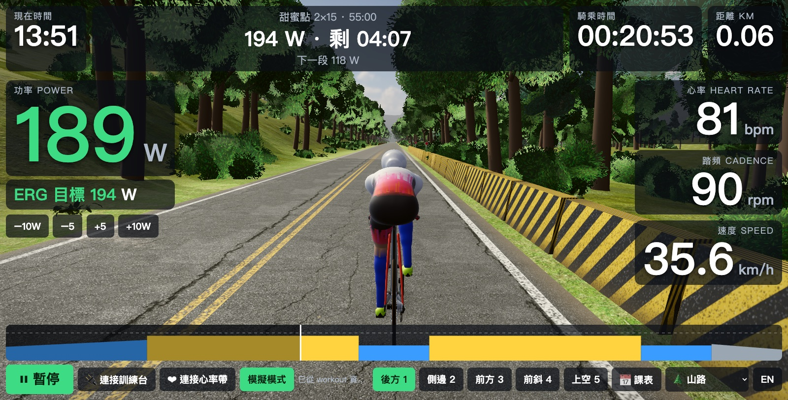
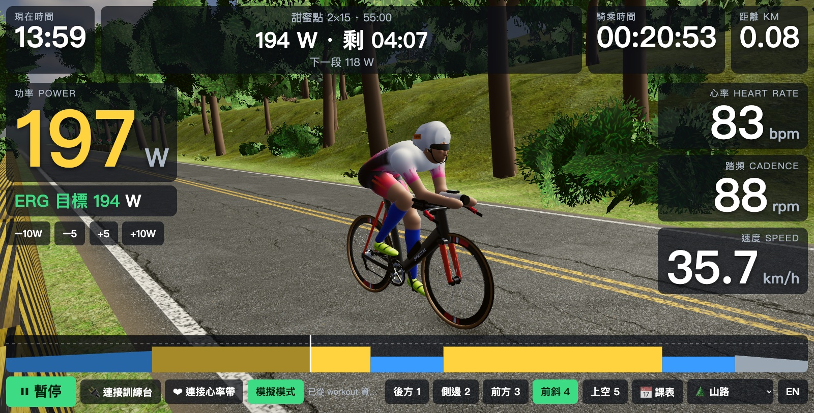
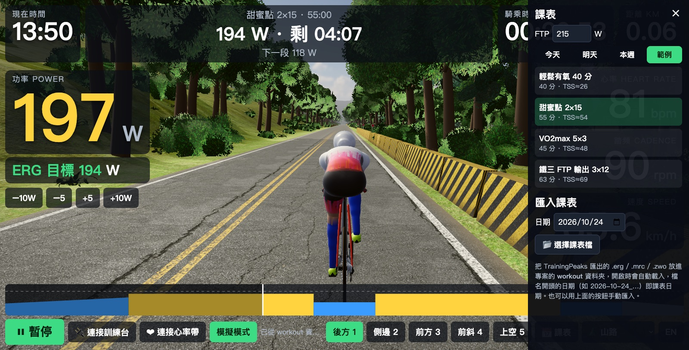
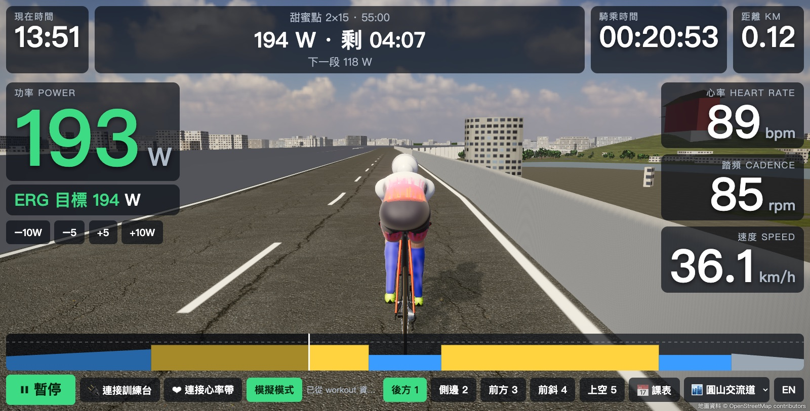
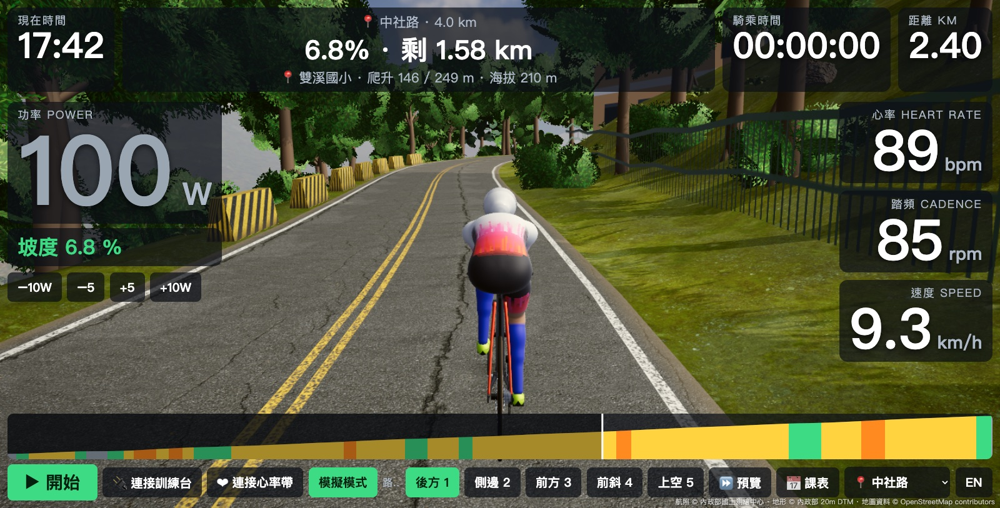
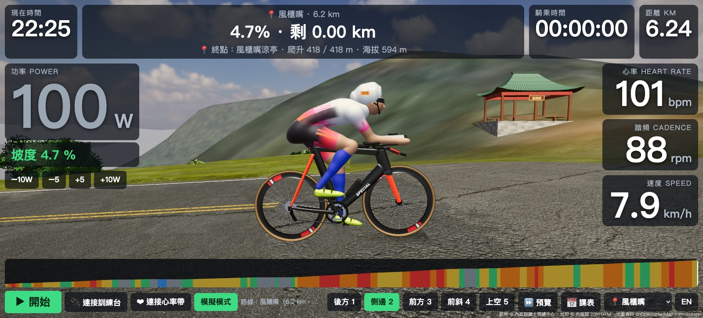

# Hud Iron Virtual Cycling

**繁體中文** | [English](README.en.md)

Hud Iron-「哈鐵」就是很「哈」鐵人三項

瀏覽器版的智慧訓練台騎乘軟體（類似 Zwift / Rouvy 的第一版）。介面可即時切換中文 / English。

**目前版本：v0.2.0**（2026-11-01）

### v0.2.0 新增
- 匯入 GPX 路線騎乘：訓練台阻力跟著坡度變化（FTMS SIM 模式），速度依功率與坡度計算，HUD 顯示坡度、剩餘距離、爬升與高度剖面
- 預覽快轉（按鈕或 P 鍵，1× / 4× / 16×），點高度剖面可跳到路線任一處
- 內建實景路線「中社路」：內政部 DTM 真實地形、國土測繪中心正射航照、OpenStreetMap 房屋 / 道路 / 溪流，起點外雙溪橋
- 沿途地標：翠山派出所、雙溪國小、公車站牌；終點公車迴轉道（黃色網狀線）、流動廁所與翠山步道石碑；接近時 HUD 顯示名稱
- `tools/make_route_gpx.py`：用道路名稱從 OpenStreetMap 產生 GPX 與實景資料

v0.1.0：ERG 課表騎乘、Web Bluetooth 訓練台 / 心率帶、3D 世界與五種視角、圓山交流道場景、中英文即時切換



## 功能
- Web Bluetooth 連接智慧訓練台（FTMS 協定）與心率帶
- 預設 ERG 模式，依課表自動控制訓練台功率；選了課表就以課表瓦數為準，可用 ±5 / ±10 W 微調
- 課表：把 TrainingPeaks 匯出的 `.erg` / `.mrc` / `.zwo` / `.json` 放進 `workout/` 資料夾即自動載入（檔名開頭日期如 `2026-10-24_…` 即課表日期；ERG 依檔內 FTP 換算），也可手動匯入；依今天、明天、本週分類，另附範例課表
- 大字體數據：功率（依區間變色）、ERG 目標、心率、踏頻、速度、距離、時間、目前區段剩餘時間、課表進度圖
- 3D 世界（Three.js）：三鐵車與騎士，踩踏動作跟隨踏頻；後方、側邊、前方、前斜、上空五種視角
- GPX 路線騎乘：可匯入自己的 GPX 檔，依路線的坡度控制訓練台阻力（FTMS SIM 模式），速度依功率與坡度即時計算，HUD 顯示坡度、剩餘距離、爬升與高度剖面；內建實景路線「中社路」與「風櫃嘴」（真實地形、正射航照、房屋與道路）
- 騎乘中可切換場景與語言，課表進度和藍牙連線不受影響

| 前斜視角 | 課表側邊欄 |
|---|---|
|  |  |

## 執行
```bash
python3 tools/serve.py        # 本機伺服器（不快取，改完程式重新整理即生效）
```
用 Chrome 或 Edge 開啟 http://localhost:8000 （Web Bluetooth 需要 localhost 或 https）。
沒有訓練台時可按「模擬模式」預覽。

快捷鍵：`1`–`5` 切換視角、空白鍵開始/暫停、上下方向鍵調整 ERG 目標 ±5W、`L` 切換中文 / English。

## 場景
- 🌲 山路：程式生成的無限延伸林蔭山路（預設）
- 🏙 圓山交流道（實驗）：依 OpenStreetMap 資料生成的台北圓山交流道一帶，沿中山高北上主線騎乘約 3.65 km。可用畫面右下角選單或網址 `?map=yuanshan` 切換。
  重新抓取地圖資料：`/opt/homebrew/bin/python3 tools/fetch_osm.py`



## GPX 路線
- 在「課表」側邊欄的「路線」區選擇路線，或按「📂 匯入 GPX」；也可以把 `.gpx` 放進 `routes/` 資料夾（個人路線，不會上傳到 GitHub），開啟時自動載入。
- 沒選課表時，訓練台阻力跟著坡度變化（SIM 模式）；有選課表則仍以課表瓦數控制（ERG），路線只決定畫面與速度。
- 速度依物理模型計算：騎士＋車 82 kg、CdA 0.24、Crr 0.004，所以爬坡會變慢、下坡會變快。
- 內建實景範例「中社路」（台北士林，約 4.0 km、爬升約 252 m、平均約 6.3%）：
  - 路段取自 OpenStreetMap，高度與周邊 3.7 × 3.1 km 的地形來自內政部 20 公尺數值地形模型（DTM）
  - 地面顏色來自國土測繪中心的正射航照，騎乘時才從國土測繪中心的圖磚服務即時載入（不存進 repo，需要網路；離線時改用一般草地）
  - 房屋、側路、溪流照 OpenStreetMap 擺放；樹木只種在航照上是植被的地方，路旁有房子的路段行道樹較少。樹的樣子、房屋外觀仍是程式生成，近看不是實景
  - 路寬依 OSM 各路段（起點路口較寬、二段山路較窄，髮夾彎自動加寬）；起點的外雙溪橋有橋面、護牆、橋墩，溪流從橋下流過
  - 沿途地標：翠山派出所（白牆藍帶與招牌）、雙溪國小（校舍、圍牆、校門招牌、球場）、31 個公車站牌，終點是畫上黃色網狀線的中社公車迴轉道，旁邊有兩座藍色流動廁所和翠山步道入口的石碑；接近地標時 HUD 會顯示名稱
- 內建實景路線「風櫃嘴」（台北士林，約 6.3 km、爬升約 420 m、平均約 6.6%）：北部車友的經典爬坡，從至善路三段的楓林橋出發，經 150 巷、290 巷、336 巷接萬溪產業道路，爬到士林與萬里交界的風櫃嘴埡口
  - 做法同中社路；埡口東側屬新北市，地形另外合併新北市的 DTM
  - 終點是風櫃嘴涼亭（OSM 標示的位置與大小，綠瓦翹角、木紋柱、石砌平台、「風櫃嘴」匾額；外觀是一般山區涼亭的樣式，不是照片建模），終點路口鋪了柏油接上萬崁公路與萬溪產業道路；沿途有公車站牌
  - 終點前約 830 m，坡上的岩壁刻著紅色的「佛」字（位置取 OSM 標示的岩壁；OSM 不記錄題字，由 `--inscription` 指定）；最後約 1 km 左側不種樹，保留開闊的山景（`--open`）
- 用道路名稱產生其他路線：
  ```bash
  /opt/homebrew/bin/python3 tools/make_route_gpx.py 中社路 --names 中社路一段,中社路二段,外雙溪橋 \
      --bbox 25.08,121.52,25.16,121.60 --title 中社路 --out assets/routes/zhongshe.gpx
  ```
  同名道路有支線、只走其中一段時，加上 `--from 緯度,經度 --to 緯度,經度` 改取兩點間的最短路徑，例如風櫃嘴：
  ```bash
  /opt/homebrew/bin/python3 tools/make_route_gpx.py 風櫃嘴 --names 楓林橋,至善路三段150巷,至善路三段290巷,至善路三段336巷,萬溪主線產業道路 \
      --bbox 25.10,121.56,25.15,121.62 --from 25.11922,121.58272 --to 25.13715,121.60264 --title 風櫃嘴 --out assets/routes/fengguizui.gpx \
      --dem .cache/dem/taipei,.cache/dem/newtaipei --scene assets/routes/fengguizui.scene.json \
      --inscription 25.13051,121.59872,佛 --open 5200-:L --skip 溪山派出所
  ```
  加上 `--dem .cache/dem/taipei --scene assets/routes/zhongshe.scene.json` 會改用內政部 DTM 並輸出實景資料（路線跨縣市時 `--dem` 可用逗號列出多個資料夾）。DTM 從政府資料開放平臺「全臺灣20公尺網格數值地形模型DTM資料」下載對應縣市的分幅檔（例如 `分幅_臺北市20MDEM(2024).zip`），解壓到 `.cache/dem/` 下的資料夾；沒有 `--dem` 時高度改用 SRTM / ASTER 30m。





## 授權
- 程式碼：[MIT License](LICENSE)
- `assets/osm/yuanshan.json`、`assets/routes/*.gpx`、`assets/routes/*.scene.json`：由 OpenStreetMap 資料整理而成，© [OpenStreetMap](https://www.openstreetmap.org/copyright) contributors，採 [ODbL 1.0](https://opendatacommons.org/licenses/odbl/1-0/) 授權（不適用 MIT）
- `assets/routes/*.gpx` 的高度與 `assets/routes/*.scene.json` 的地形：內政部 20 公尺數值地形模型，採[政府資料開放授權條款第 1 版](https://data.gov.tw/license)；`*.scene.json` 的房屋、道路、溪流另受 ODbL 規範
- 正射航照：© 內政部國土測繪中心，騎乘時從其 WMTS 圖磚服務即時載入，本 repo 不含任何航照圖磚；`docs/screenshots/route-*.jpg` 截圖畫面含航照，依[國土測繪中心服務使用條款](https://maps.nlsc.gov.tw/pro/use_clause.jsp)標示來源後展示
- 未使用 DTM 產生的路線，高度來自 SRTM（NASA，公眾領域）與 ASTER GDEM（METI / NASA），經 [OpenTopoData](https://www.opentopodata.org) 查詢
- `assets/hdri/`、`assets/tex/`、`assets/models/`：HDRI 天空、柏油/草地材質、草叢/蕨類/岩石模型來自 [Poly Haven](https://polyhaven.com)，採 [CC0](https://creativecommons.org/publicdomain/zero/1.0/)（公眾領域）

## 免責聲明
本專案為個人非商業作品，與 Zwift、Rouvy、TrainingPeaks、Garmin、Specialized、Zoot 等公司無任何關聯，亦未獲其授權或背書。文中提及的產品名稱與商標均屬各自所有人，僅用於說明相容性或描述用途。3D 車輛與服裝為程式繪製的近似外觀，未使用任何官方圖檔或商標標誌。
