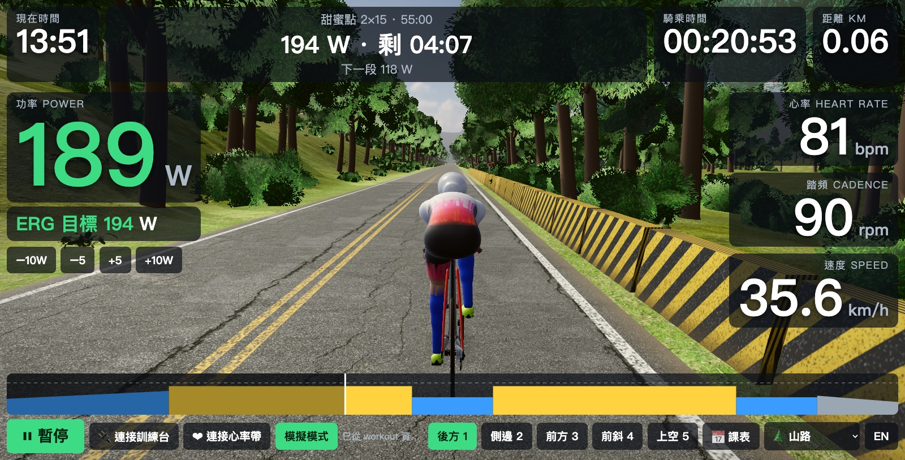
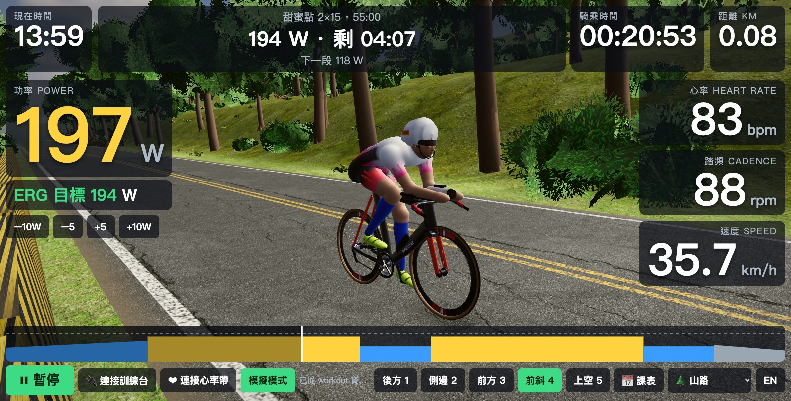
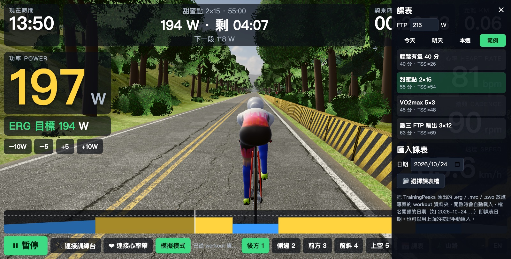
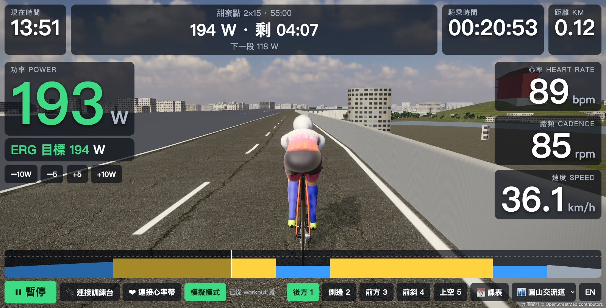

# Iron Hud Virtual Cycling

**繁體中文** | [English](README.en.md)

瀏覽器版的智慧訓練台騎乘軟體（類似 Zwift / Rouvy 的第一版）。介面可即時切換中文 / English。



## 功能
- Web Bluetooth 連接智慧訓練台（FTMS 協定）與心率帶
- 預設 ERG 模式，依課表自動控制訓練台功率；選了課表就以課表瓦數為準，可用 ±5 / ±10 W 微調
- 課表：把 TrainingPeaks 匯出的 `.erg` / `.mrc` / `.zwo` / `.json` 放進 `workout/` 資料夾即自動載入（檔名開頭日期如 `2026-10-24_…` 即課表日期；ERG 依檔內 FTP 換算），也可手動匯入；依今天、明天、本週分類，另附範例課表
- 大字體數據：功率（依區間變色）、ERG 目標、心率、踏頻、速度、距離、時間、目前區段剩餘時間、課表進度圖
- 3D 世界（Three.js）：三鐵車與騎士，踩踏動作跟隨踏頻；後方、側邊、前方、前斜、上空五種視角
- 騎乘中可切換場景與語言，課表進度和藍牙連線不受影響

| 前斜視角 | 課表側邊欄 |
|---|---|
|  |  |

## 執行
```bash
python3 tools/serve.py        # 本機伺服器（不快取，改完程式重新整理即生效）
```
用 Chrome 或 Edge 開啟 http://localhost:8000 （Web Bluetooth 需要 localhost 或 https）。
沒有訓練台時可按「模擬模式」預覽。

快捷鍵：`1`–`5` 切換視角、空白鍵開始/暫停、上下方向鍵調整 ERG 目標 ±5W、`L` 切換中文 / English。

## 場景
- 🌲 山路：程式生成的無限延伸林蔭山路（預設）
- 🏙 圓山交流道（實驗）：依 OpenStreetMap 資料生成的台北圓山交流道一帶，沿中山高北上主線騎乘約 3.65 km。可用畫面右下角選單或網址 `?map=yuanshan` 切換。
  重新抓取地圖資料：`/opt/homebrew/bin/python3 tools/fetch_osm.py`



## 授權
- 程式碼：[MIT License](LICENSE)
- `assets/osm/yuanshan.json`：由 OpenStreetMap 資料整理而成，© [OpenStreetMap](https://www.openstreetmap.org/copyright) contributors，採 [ODbL 1.0](https://opendatacommons.org/licenses/odbl/1-0/) 授權（不適用 MIT）
- `assets/hdri/`、`assets/tex/`、`assets/models/`：HDRI 天空、柏油/草地材質、草叢/蕨類/岩石模型來自 [Poly Haven](https://polyhaven.com)，採 [CC0](https://creativecommons.org/publicdomain/zero/1.0/)（公眾領域）

## 免責聲明
本專案為個人非商業作品，與 Zwift、Rouvy、TrainingPeaks、Garmin、Specialized、Zoot 等公司無任何關聯，亦未獲其授權或背書。文中提及的產品名稱與商標均屬各自所有人，僅用於說明相容性或描述用途。3D 車輛與服裝為程式繪製的近似外觀，未使用任何官方圖檔或商標標誌。
